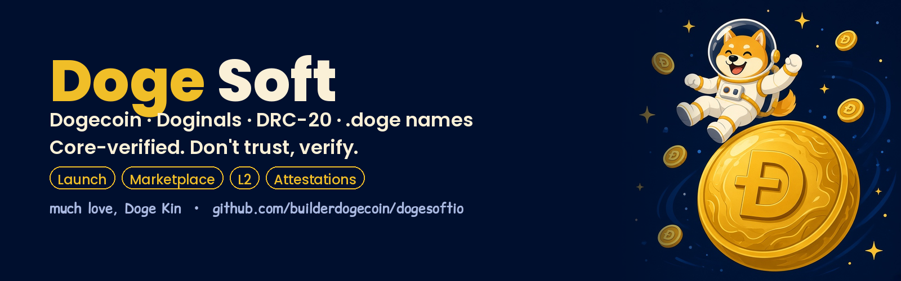
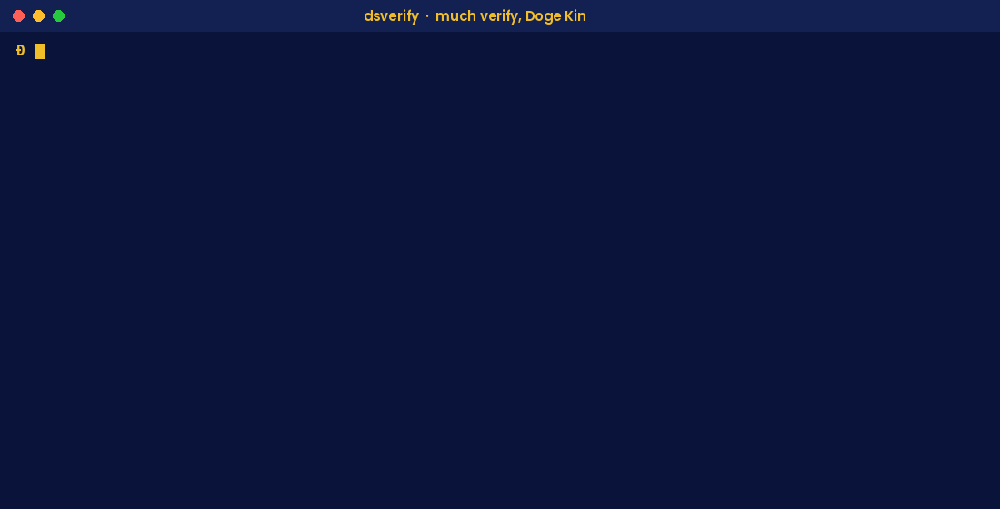
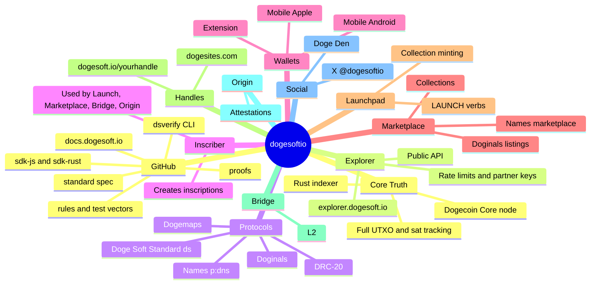

<p align="center">
  
</p>

<h1 align="center">Doge Soft</h1>

<p align="center">
  <b>The Core-verified home of Dogecoin, Doginals, DRC-20 Coins and .doge names.</b><br>
  Don't trust. Verify. Much love from the Orbit to every Doge Kin.
</p>

<p align="center">
  <a href="https://explorer.dogesoft.io">Explorer</a> ·
  <a href="https://docs.dogesoft.io">Docs</a> ·
  <a href="https://dogesoft.io">dogesoft.io</a> ·
  <a href="https://x.com/dogesoftio">@dogesoftio</a>
</p>

<p align="center">
  <a href="https://github.com/builderdogecoin/dogesoftio/actions/workflows/ci.yml"></a>
  <a href="https://github.com/builderdogecoin/dogesoftio/releases/latest"></a>
  
  
</p>

---

## Wow. Such chain. Very verified.

Doge Soft is one connected Orbit for Dogecoin: a self-custody **wallet**, an indexer-backed **explorer**, **DRC-20 Coins**, **Doginals** inscriptions, readable **.doge names**, a **marketplace**, collection **launches** and a **bridge** to the Doge Soft L2. Every piece agrees on one thing: **Dogecoin Core is the source of truth.**

This repo is where you can check that for yourself. It holds the protocol rules our index follows, written out in full, real test cases, published proofs, and the tools to compare any answer against your own Dogecoin Core node. It speaks to the Doge in all of us: curious, friendly, and allergic to "just trust me".

## The proof, in one line

At block **6,453,225**, the Doge Soft DRC-20 index had **zero differences** against a strict ledger rebuilt from Dogecoin Core:

| What was compared | Count | Differences |
|---|---:|---:|
| DRC-20 Coins (ticks) | 71,689 | 0 |
| Balances | 1,702,438 | 0 |
| Open transfer locks | 528,006 | 0 |
| Holder counts | every coin | 0 |

Every figure traces back to a Core block and transaction. See [`proofs/`](proofs/).

## What's in here

| Folder | What it is |
|---|---|
| [`docs/`](docs/) | Newbie-friendly guides, glossary, FAQ, ecosystem map |
| [`rules/`](rules/) | The Doginals and DRC-20 protocol rules exactly as the index follows them, plus test vectors |
| [`proofs/`](proofs/) | Published checkpoints tied to Core block hashes |
| [`dsverify/`](dsverify/) | The command-line verifier you run against your own Dogecoin Core |
| [`sdk-js/`](sdk-js/) | JavaScript / TypeScript SDK for the public Explorer API |
| [`sdk-rust/`](sdk-rust/) | Rust SDK for the public Explorer API |

## Start in 5 minutes (no node needed)

The public Explorer API answers read questions for free. Try it from any terminal:

```bash
# Is the index up, and how close to the chain tip?
curl https://explorer.dogesoft.io/api/health

# A DRC-20 Coin
curl "https://explorer.dogesoft.io/api/explorer/drc20/DU%24T"

# A .doge name
curl https://explorer.dogesoft.io/api/names/resolve/soft.doge

# Every DRC-20 Coin an address holds
curl https://explorer.dogesoft.io/api/wallet/address/<your-D-address>/drc20
```

More in [docs/api-quickstart.md](docs/api-quickstart.md).

## Go deeper in 30 minutes (your own Core)

Run a stock Dogecoin Core node with `txindex=1`, then let **dsverify** check our answers against it and print `PASS` or `DIFF`. No patched or special node, no Doge Soft server in the loop.

<p align="center"></p>

Grab the signed binary for Windows, Linux or macOS from [Releases](https://github.com/builderdogecoin/dogesoftio/releases/latest). Guide: [docs/verify-with-your-own-core.md](docs/verify-with-your-own-core.md).

## The Orbit at a glance



The full map lives in [docs/ecosystem-map.md](docs/ecosystem-map.md).

## Words we use on purpose

We say **DRC-20 Coins**, never "tokens". They are fungible units inscribed on Dogecoin L1 itself, not IOUs on someone else's ledger. New to all this? The [glossary](docs/glossary.md) explains inscriptions, UTXOs, koinu and Core in plain English.

## Join the Orbit

- Read the [FAQ](docs/faq.md) and [SUPPORT.md](SUPPORT.md).
- Found a bug or a DIFF? Open an issue. We love a good DIFF; it makes the Orbit stronger.
- Want to help? See [CONTRIBUTING.md](CONTRIBUTING.md).
- Security issue? Please follow [SECURITY.md](SECURITY.md) and don't open a public issue.
- **Never share your seed phrase or private key** with anyone, including anyone who says they're from Doge Soft. Much safe, very self-custody.

## License

Code is Apache-2.0, specs and docs are CC-BY-4.0, test vectors and proofs are CC0. Details in [LICENSING.md](LICENSING.md). "Doge Soft" and its logos are not licensed for use as your own brand.

<p align="center"><i>Much Dogecoin. Very Core-verified. Such love. — the Doge Soft Orbit</i></p>
