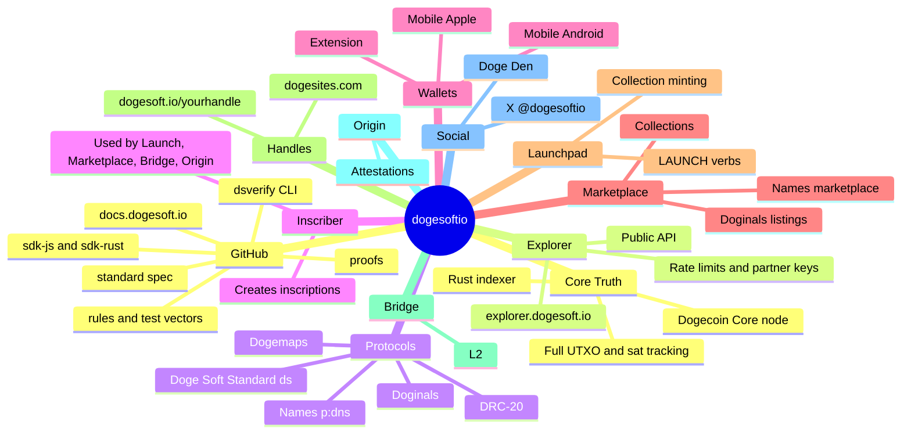

# The Doge Soft Orbit

Everything has a job. Everything talks. And everything agrees that Dogecoin Core is the source of truth. GitHub draws this map for you:

## Who does what

| Piece | Job |
|---|---|
| Dogecoin Core | The chain. The final word on every coin and transaction. |
| Indexer | Watches each block and records the UTXO set, which koinu each inscription rides, and every DRC-20 deploy, mint, transfer and balance. |
| Explorer | The website and read API of that same index. |
| Wallets | Hold the keys and sign on your device. The extension injects `window.dogesoft` for apps. |
| Inscriber | Writes inscriptions and the `ds` tag for Launch, Marketplace, Bridge and Origin. It does not keep the ledger. |
| Marketplace | Listings and offers are signed records; a sale is one Dogecoin transaction with a Doge Soft tag. |
| Launchpad | Collection launches with `LAUNCH_DEPLOY` and `LAUNCH_MINT`. |
| Handles | Your page at dogesoft.io/yourhandle, and building with dogesites.com. |
| Bridge | Moves DRC-20 Coins between Dogecoin L1 and the Doge Soft L2. |
| Origin | Attestations: signed Dogecoin facts, and an overview of how the Doge Soft tech fits together. |
| GitHub | This repo: rules, vectors, proofs, verifier and SDKs. |

Deeper dive: [docs.dogesoft.io/architecture](https://docs.dogesoft.io/architecture).
