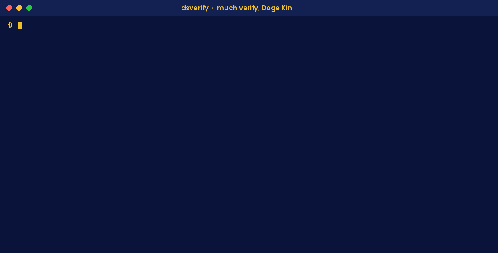

# dsverify

**Don't trust any indexer. Check it against your own Dogecoin Core.**

dsverify is a small command-line tool for every Doge Kin who'd rather check than trust. Point it at a stock Dogecoin Core node and it verifies Doginals ownership and location, DRC-20 Coin balances and holder counts, and .doge names, using the open Doge Soft [rules](../rules/). Add `--api` and it compares the Doge Soft Explorer's answer and prints `PASS` or `DIFF`. Much check. Very trustless.

<p align="center"></p>

## Highlights

- **Your node, your truth.** Talks only to your own Dogecoin Core over RPC. Works with any stock Core that has `txindex=1`. Nothing patched or special.
- **Shows its work.** Every answer prints the Core block hash and the transactions it walked.
- **One binary.** Windows, Linux and macOS (Intel and Apple Silicon). Signed, with SHA-256 checksums.
- **Script friendly.** Exit code `0` PASS, `1` DIFF, `2` could not check.
- **Same rules as production.** Built from the Doge Soft index's own parsing, koinu-position and DRC-20 rule code.

## Commands

| Command | What it checks |
|---|---|
| `dsverify doctor` | RPC login, mainnet, synced, unpruned, `txindex` on |
| `dsverify inscription <id>` | Where a Doginal is and who owns it, traced back hop by hop to its reveal |
| `dsverify replay` | Replays the chain from your own Core into a local database, with the open rules |
| `dsverify drc20 balance <address> <tick>` | Available and transferable balance, from your replay |
| `dsverify drc20 holders <tick>` | Holder count, from your replay |
| `dsverify drc20 token <tick>` | Deploy, max, limit, decimals and minted supply, from your replay |
| `dsverify name <name>` | A .doge name's first valid claim and its holder, from your replay |
| `dsverify vectors run [--node]` | Every published test vector; `--node` also matches the mainnet ones byte for byte with your Core |
| `dsverify proof check <height>` | A published checkpoint in [`proofs/`](../proofs/): block hash, then state hashes |
| `dsverify proof export --out <dir>` | Writes your replay's canonical tables and their SHA-256 |
| `--api [url]` | Compare with the Explorer API (default `https://explorer.dogesoft.io`) and print PASS or DIFF |

### About `replay`

DRC-20 balances, holder counts and names depend on every Doginal before them, so the trustless way to check them is to replay history yourself. `dsverify replay` reads the blocks from your own Core, checks each block's hash, applies the rules, and saves its state in one SQLite file (default: `dsverify/state.db` inside Core's data directory, or `--db <file>`).

- The first run is the long one: plan on several hours on a fast SSD, and a few tens of GB of disk.
- It saves after every batch, so stop it any time and run it again to resume.
- Later runs are incremental: only the new blocks.
- It stays 12 blocks behind the tip (`--confirmations`) so a reorg never touches saved state.
- `--to <height>` stops at a height, for example to check a published checkpoint.

## Example

Real output, from a stock Dogecoin Core on Windows:

```text
> dsverify doctor
  rpc      http://127.0.0.1:22555/  login from dogecoin.conf
  chain    main  PASS
  synced   blocks 6453514  headers 6453514  OK
  pruned   false  OK
  txindex  OK

> dsverify inscription ff78a7b32c6761118cd58fd2f6707317a4e4e9c23a8abff89b446ac1067a906fi0 --api
  reveal   ff78a7b32c6761118cd58fd2f6707317a4e4e9c23a8abff89b446ac1067a906f  envelope in input 0  9 bytes  text/plain;charset=utf-8  OK
           content sha256 61aef9f5f82ab70fc32a857afa225cf091ba2beab7363ccc737009bba98c566e
  hops     0
  now at   ff78a7b32c6761118cd58fd2f6707317a4e4e9c23a8abff89b446ac1067a906f:0  offset 0  unspent  owner DBTAJUFHd3EftS6jnEdsHMsFXdeMBuacmj  OK
  API says owner DBTAJUFHd3EftS6jnEdsHMsFXdeMBuacmj  location ff78a7b32c6761118cd58fd2f6707317a4e4e9c23a8abff89b446ac1067a906f:0:0  PASS

> dsverify vectors run --node
  envelope                  4000 checks  PASS
  drc20 bodies                86 checks  PASS
  koinu routing            32141 checks  PASS
  mainnet reveals             12 checks  PASS
  mainnet reveals vs Core      12 checks  PASS
```

dsverify never prints your RPC login. It only ever calls read-only Core methods (`getblockchaininfo`, `getnetworkinfo`, `getblockcount`, `getblockhash`, `getblockheader`, `getblock`, `getrawtransaction`, `gettxout`); anything else is refused before it is sent.

## Install

Download the signed binary for your system from [Releases](https://github.com/builderdogecoin/dogesoftio/releases/latest), check the SHA-256, and run `dsverify doctor`. Full walkthrough, Windows included: [docs/verify-with-your-own-core.md](../docs/verify-with-your-own-core.md).

## Build from source

```bash
cd dsverify
cargo build --release --locked
```

The toolchain is pinned in `rust-toolchain.toml`. Release builds and how to reproduce their checksums: [REPRODUCIBLE.md](REPRODUCIBLE.md).

Run the tests (they include every published vector):

```bash
cargo test --locked
```

## License

Apache-2.0. See [LICENSING.md](../LICENSING.md).
